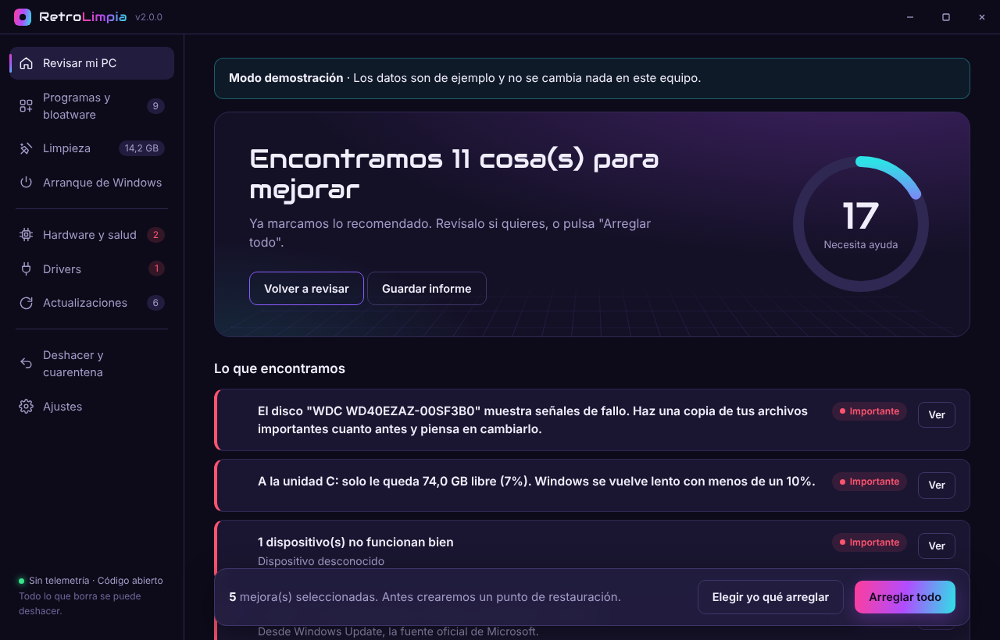
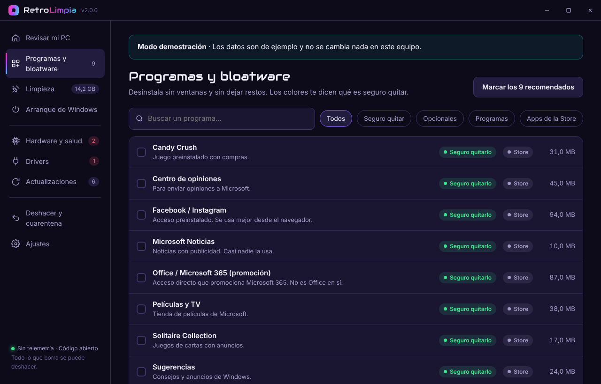
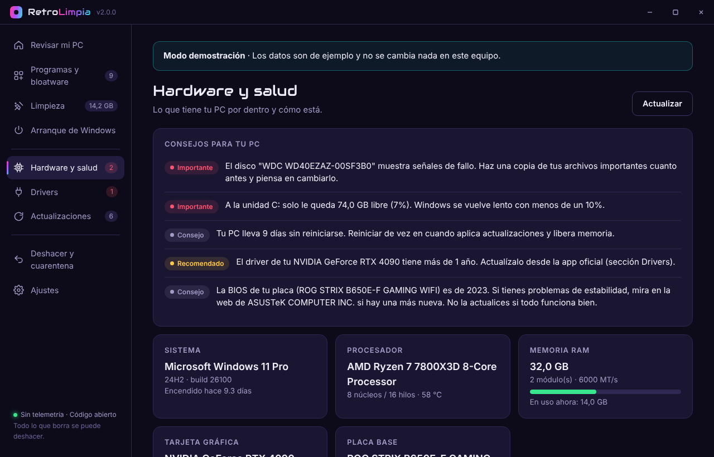

# RetroLimpia

**Limpia tu PC, quita el bloatware sin dejar restos, revisa tu hardware y mantén tus drivers al día. Todo guiado paso a paso, pensado para quien no sabe nada de informática.**

Gratis · Código abierto (MIT) · Sin telemetría · Todo se puede deshacer



## Descargar

Ve a **[Releases](../../releases/latest)** y elige una opción:

- `RetroLimpia-Instalador-x.y.z.exe`: se instala como cualquier programa (recomendado).
- `RetroLimpia-Portable-x.y.z.exe`: no se instala; se abre directamente, por ejemplo desde un USB.

> **¿Windows dice "Windows protegió su PC"?** Es normal y no significa que tenga un virus: el programa no tiene una firma digital de pago. Pulsa **Más información → Ejecutar de todas formas**. [Aquí te explicamos por qué pasa y cómo comprobarlo tú mismo](docs/POR-QUE-AVISA-WINDOWS.md).

## Qué hace

| | |
|---|---|
| **Revisar mi PC** | Un solo botón lo analiza todo y da una **nota de salud del 1 al 100**. Después, "Arreglar todo" aplica lo recomendado. |
| **Programas y bloatware** | Desinstala en silencio, sin el asistente de cada programa. Muestra cuánto pesa cada uno y su **impacto en el sistema** (si arranca con Windows, servicios y RAM). Marca cada programa en **verde** (seguro quitarlo), **amarillo** (opcional) o **rojo** (mejor no tocar). |
| **Restos** | Al desinstalar, busca carpetas, accesos directos y registro que el programa dejó. Lo que seguro es suyo se quita solo; lo dudoso te lo pregunta. |
| **Limpieza** | Temporales, caché de Windows Update, informes de error, miniaturas y caché de navegadores. Nunca toca documentos, contraseñas ni historial. |
| **Arranque** | Desactiva los programas que arrancan con Windows sin hacer falta. Usa el mismo interruptor que el Administrador de tareas. |
| **Hardware y salud** | CPU, gráfica, RAM, placa, BIOS, batería. **Salud y desgaste de los discos**, temperaturas y consejos fáciles de entender. |
| **Drivers** | Dispositivos con problemas, drivers antiguos y copia de seguridad de tus drivers. Solo fuentes oficiales: Windows Update y la app de NVIDIA, AMD o Intel. |
| **Actualizaciones** | Windows, drivers y programas (con winget): marca los que quieras o actualiza **todo de una vez**. |
| **Recordatorios** | Opcional: arranca en silencio con Windows y te avisa con una notificación cuando hay basura acumulada o actualizaciones pendientes. |
| **Procesos (avanzado)** | Qué consume más CPU y RAM ahora mismo, con opción de cerrarlo. Los procesos vitales de Windows están protegidos. |
| **Deshacer** | Punto de restauración antes de cada cambio y **cuarentena de 7 días** con botón de restaurar. |




## Seguridad

- **Lista de protegidos:** los drivers, Visual C++, .NET, la Store y otras piezas del sistema no se pueden quitar, salvo en modo experto.
- **Rutas prohibidas:** RetroLimpia nunca toca carpetas como `Windows`, `System32` o tu carpeta de usuario, aunque una búsqueda de restos las señale.
- **Sin webs de "drivers gratis":** los drivers vienen solo de Windows Update o del fabricante.
- **Sin telemetría:** no envía datos de tu PC a ningún sitio.
- **Registro de cambios:** cada cambio queda anotado en `C:\ProgramData\RetroLimpia\logs`.

## Para desarrolladores

Está hecho con **Electron** (interfaz) y **PowerShell 5.1** (motor). El motor es el PowerShell que ya viene con Windows, así que no hay que instalar nada más. Tampoco depende de bases de datos externas que mantener: pregunta a Windows en el momento.

```
src/        proceso principal, puente seguro y motor que lanza los scripts (sin ventanas)
scripts/    un .ps1 por función; devuelven JSON (@@PROGRESS / @@RESULT)
data/       listas editables: bloatware.json, protegidos.json, inicio.json
renderer/   interfaz (HTML + CSS + JS, sin frameworks)
```

```bash
npm install
npm run demo     # interfaz con datos de ejemplo; no toca nada
npm start        # modo real (ábrelo como administrador)
npm run dist     # genera el instalador y la versión portable en dist/
```

**Añadir bloatware o reglas** es tan fácil como editar los archivos de `data/`. Los patrones admiten `*`.

**Publicar una versión:** cambia `version` en `package.json`, haz commit y crea una etiqueta `vX.Y.Z`. GitHub Actions compila el .exe y publica la Release con sus huellas SHA-256.

## Apoya el proyecto

RetroLimpia es gratis, sin anuncios y sin telemetría. Si te ha servido, puedes invitarme un café: https://streamelements.com/retropunk94/tip

## Licencia

MIT: úsalo, modifícalo y compártelo libremente.
